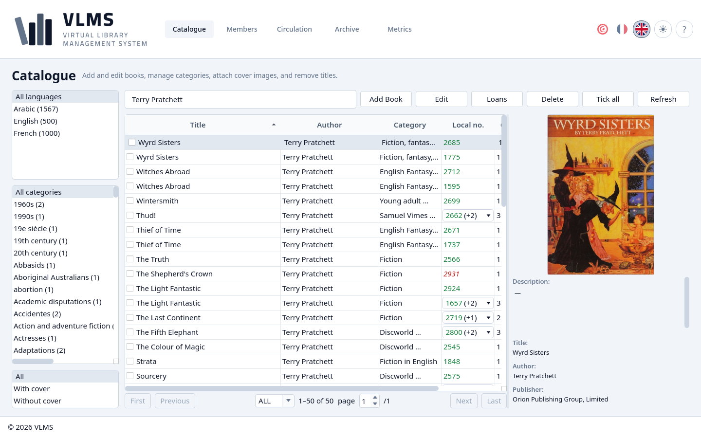

# VLMS

VLMS is a desktop application for a library desk. It keeps the catalogue, the members, and the loans, and it is where a book is added, a member is registered, and a copy goes out and comes back.

The interface is in Arabic, French, and English.



## What it does

- **Catalogue** — titles, copies, and local numbers. A cover image can be read with OCR when Tesseract is available.
- **Members** — who may borrow, and until when, including photographs and identity-card images.
- **Circulation** — lending, return, and extension.
- **Archive** — records that were removed, and what can still be restored.
- **Metrics** — a short picture of the library: stock, members, and recent activity.

The manual shipped with the application is under [`docs/manual/`](docs/manual/index.html). It can also be read online at <https://medaminben.github.io/VLMS/>.

A development build opens the sample catalogue in [`database/vlms.db`](database/vlms.db), with cover images and member photographs under [`resources/`](resources/). The images are not tracked: the build steps below download them once. That data is for trying the program. It is not a live library.

## Requirements

- CMake 3.21 or newer
- A C++20 compiler
- Qt 6 (Widgets, Gui, Core)
- SQLite 3
- Ninja, if you use the commands below

OCR is optional. Without Tesseract and Leptonica the program still builds, and the “from image” action stays unavailable.

## Build and run

On Debian or Ubuntu:

```bash
sudo apt-get update
sudo apt-get install -y --no-install-recommends \
  build-essential cmake ninja-build \
  qt6-base-dev qt6-base-dev-tools \
  libsqlite3-dev libgl1-mesa-dev

# Optional, for cover OCR:
# sudo apt-get install -y libtesseract-dev libleptonica-dev \
#   tesseract-ocr-ara tesseract-ocr-fra tesseract-ocr-eng

# Sample cover images and member photographs, once per checkout:
./scripts/fetch_runtime_data.sh

cmake -S . -B build -G Ninja -DCMAKE_BUILD_TYPE=Release
cmake --build build
./build/bin/vlms
```

On Windows, install [MSYS2](https://www.msys2.org/) and run these commands in its **MSYS2 MINGW64** shell, from the repository folder:

```bash
pacman -S --needed \
  mingw-w64-x86_64-gcc mingw-w64-x86_64-cmake mingw-w64-x86_64-ninja \
  mingw-w64-x86_64-qt6-base mingw-w64-x86_64-sqlite3

# Optional, for cover OCR:
# pacman -S --needed mingw-w64-x86_64-tesseract-ocr mingw-w64-x86_64-leptonica \
#   mingw-w64-x86_64-tesseract-data-ara mingw-w64-x86_64-tesseract-data-fra \
#   mingw-w64-x86_64-tesseract-data-eng
# powershell -File scripts/fetch_windows_ocr.ps1 -Toolchain MinGW

# Sample cover images and member photographs, once per checkout:
powershell -File scripts/fetch_installer_data.ps1

cmake -S . -B build -G Ninja -DCMAKE_BUILD_TYPE=Debug
cmake --build build
./build/bin/vlms.exe
```

Use `Debug` here, not `Release`. On Windows, a `Release` build looks for `database\` and `schema.sql` beside `vlms.exe`, in the layout the installer creates. A `Debug` build uses the sample catalogue in the source tree. Start the program from the same shell, which is where it finds the Qt and SQLite DLLs.

To build the Windows installer instead, see [`docs/windows-installer.md`](docs/windows-installer.md).

## Tests

```bash
cmake -S . -B build -G Ninja -DCMAKE_BUILD_TYPE=Debug -DVLMS_BUILD_TESTS=ON
cmake --build build
QT_QPA_PLATFORM=offscreen ctest --test-dir build --output-on-failure --no-tests=error -LE realdb
```

`QT_QPA_PLATFORM=offscreen` lets the interface tests run without a display. The `realdb` label is the suite that opens the sample catalogue; continuous integration runs it as a separate step.

The same checks run on Ubuntu in [`.github/workflows/ci.yml`](.github/workflows/ci.yml).

## Windows installer

Tagged releases can build a self-contained Windows installer. What that package contains, and how an update treats an existing catalogue, is described in [`docs/windows-installer.md`](docs/windows-installer.md).

## Licence

The source is released under the [MIT Licence](LICENSE). Copyright © 2026 Mohamed Lamine Ben Hassine.

The notice opened from the copyright line inside the application is separate. It tells the library using an installed copy that its catalogue, member records, and photographs belong to that library, and that the program is given without warranty or a duty of support.

Qt, SQLite, and (when OCR is enabled) Tesseract and Leptonica keep their own licences.
