# VLMS — Beta UML

Snapshot of **branch `Beta`** at `6017cc8` (tag lineage **v1.3.3-9-g6017cc8**,
project version **1.3.3**). SQLite `PRAGMA user_version` /
`Database::Connection::kSchemaVersion` = **7**.

This is a reverse-engineered design of the code as it stands, not a proposal.
It includes the frontend redesign that shipped in 1.3.0: list pages driven
by `ListSpec`, writes through workflows, and refreshes through `DataEvents`.
Diagrams are top-down so they print in a narrow A4 column.

---

## 1. System context

Desktop library management for one library. One process, one SQLite file,
no network service, no member login. Librarians work in five pages:
catalog, members, circulation, archive, metrics.

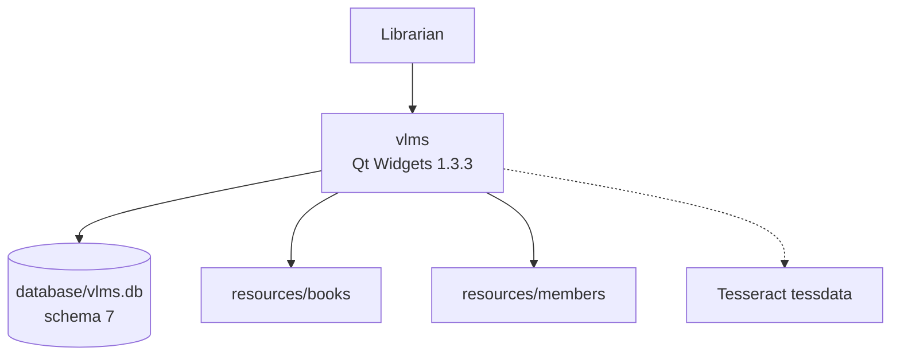

OCR is optional: if Tesseract or traineddata is missing, `Ocr::isAvailable()`
is false and the book editor disables the button.

---

## 2. Build packages

CMake produces five link units besides the executable. Boundaries that used
to be comments are **link errors**:

- `VLMS::Core` links nothing (std only).
- `VLMS::Database` is the only target that links sqlite3 (`PRIVATE`).
- `VLMS::Repositories` sees SQLite only through `SqliteSession`.
- `VLMS::Ocr` links Threads + Tesseract; no Core, no Qt.
- `vlms_ui` links Repositories publicly and Ocr privately.

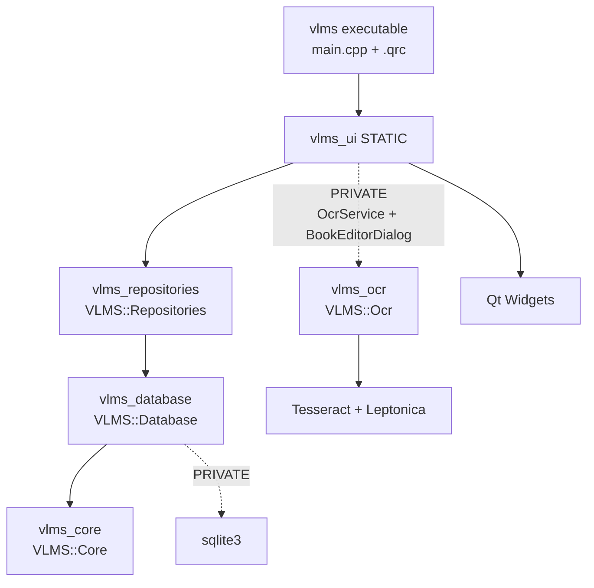

| Target | Namespace | Qt | Depends on | Public language |
| --- | --- | --- | --- | --- |
| `vlms_core` | `VLMS::Core` | no | *(none)* | `std::string`, `int64_t`, `Result<T>` / `Status` |
| `vlms_database` | `VLMS::Database` | no | Core; sqlite3 PRIVATE | `Connection`, `SqliteSession` |
| `vlms_repositories` | `VLMS::Repositories` | no | Database | repositories, records, `LoanPolicy` |
| `vlms_ocr` | `VLMS::Ocr` | no | Threads, Tesseract | `std::string`, `Ocr::Result` |
| `vlms_ui` | *(UI classes mostly global / `VLMS::`)* | yes | Repositories, Widgets, Ocr (private) | `QWidget`, `QtBridge` |
| tests | `Test::` helpers | Test | matching library and/or `vlms_ui` | `TestEnv` `qs`/`ss`/`qd`/`cd` |

Include prefixes mirror namespaces: `<VLMS/Core/…>`, `<VLMS/Database/…>`,
`<VLMS/Repositories/…>`, `<VLMS/Ocr/…>`.

---

## 3. Runtime composition

Two owners. `Application` owns persistence and the Qt adapters that sit
on it. `MainWindow` owns the workflows, the list specs, and the pages.
Repositories hold a `SqliteSession&` and must die **before** `Connection`.

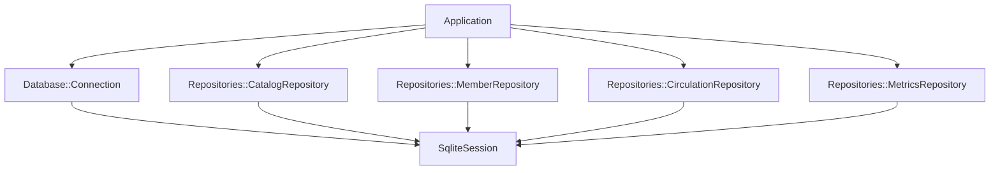

Built by `Application` once the four repositories exist (all one instance):

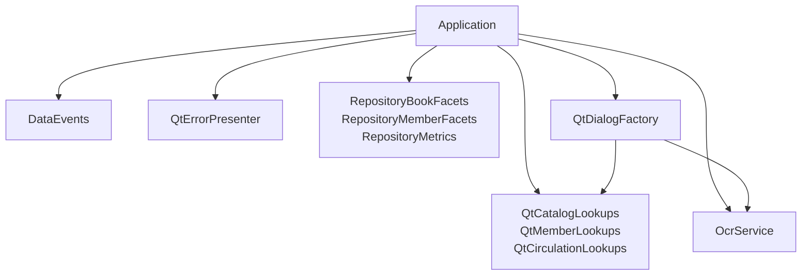

Built by `MainWindow`, which also implements `Navigator`:

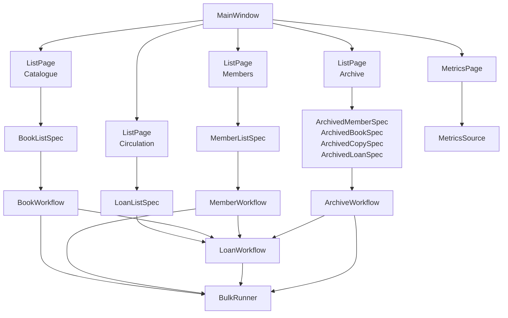

- A **spec** reads its repository directly (`load`, `cell`, `preview`) and
  exposes actions. Each action calls a workflow.
- A **workflow** is the only thing that writes. It opens windows only through
  `DialogFactory`, reports failures through `ErrorPresenter`, and announces
  every write on `DataEvents`. Multi-row actions go through the shared
  `BulkRunner`.
- Book, member, and archive workflows open loan history windows. These use
  a second `LoanListSpec` (`m_loanHistorySpec`), never Circulation's, so a
  pinned query cannot leak into the live page. Return and extend from those
  windows go through `LoanWorkflow`.
- `MainWindow` builds the facet widgets (`BookFacetFilters`,
  `MemberFacetFilters`, the loan status list, the archive type list) from
  `BookFacetSource` / `MemberFacetSource`. It maps their picks into
  `QueryState.facets` through `ListPage::setFacets`.
- The Archive page is one `ListPage`. Switching type swaps the spec with
  `ListPage::setSpec`.
- Cross-repository reads are lookups, not second owners. `LoanListSpec`
  and `ArchivedLoanSpec` read catalog and members (cover, photo).
  `ArchivedBookSpec` reads circulation (loan counts).

---

## 3.1 List page

The four list pages are one class, `ListPage`, configured by a `ListSpec`.
On screen the row is LTR (RTL flips it). The diagram is top-down so it
prints.

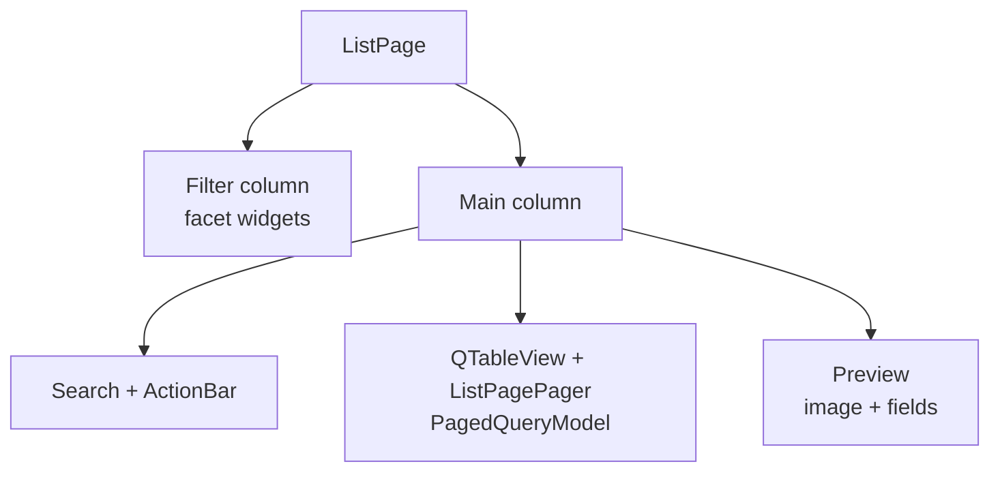

| Slot | Role |
| --- | --- |
| Filter column | Facet widgets that `MainWindow` adds. They rewrite `QueryState.facets`. |
| Search | Rewrites `QueryState.search` after a 250 ms debounce. |
| `ActionBar` | Buttons, context menu, and shortcuts from `spec->actions()`, in one standard order. |
| Table + pager | `PagedQueryModel` over the spec. Ticks are kept in the model. The selection drives the preview. |
| Preview | `spec->preview(id)` → `PreviewContent` (one or two images plus fields). |
| Error strip | Shown when `load` fails, with a Retry button. |

How each page fills the slots (action ids; every list also has `tickAll`
and `refresh`):

| | Filters | Actions | Preview image |
| --- | --- | --- | --- |
| Catalogue | `BookFacetFilters` language, category, cover (`Live`) | `loans` `add` `edit` `archive` | cover / placeholder |
| Members | `MemberFacetFilters` status, sex, year, age group, city (`Live`) | `loans` `add` `edit` `archive` | photo / placeholder |
| Circulation | loan status list + `MemberFacetFilters` (`Any`, loan years) | `return` `checkout` `extend` `archive` | cover **and** member photo |
| Archive | type list + member or book facets (`Archived`) | members, books: `loans` `restore` `purge`; copies: adds `reuse`; loans: `restore` `purge` | depends on type |
| Metrics | none | Refresh | *(not a ListPage)* |

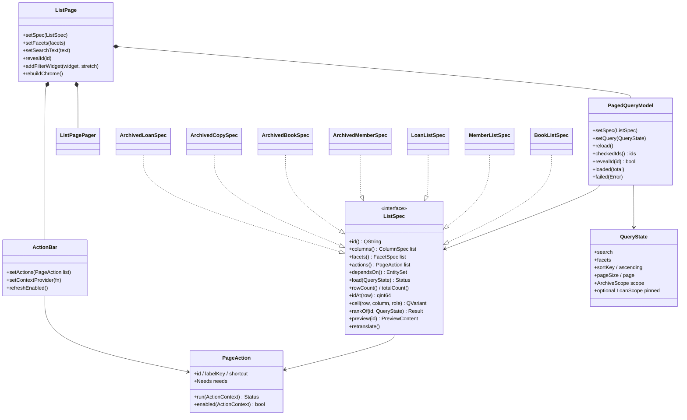

`ActionContext` is the ticked ids, or else the selected row. An action is
enabled when its `Needs` (`Nothing` / `One` / `Some`) and its optional
`enabled` rule both hold. `LoanHistoryDialog` uses the same `ActionBar`, so
a history window binds and orders its actions the same way.

`ListPagePager` opens on Show All (page size 0); 50 is the fallback size.
`rankOf` lets `revealId` jump to the page holding a row
(`Navigator::showBook`).

`MetricsPage` is not a list. It is the last user of `ListPageFrame`, which
it calls in dashboard mode (`buildDashboard`): no filters, no search, one
Refresh button, and a viewer that fills the main column.

---

## 3.2 Change propagation

Nothing refreshes a page by hand. A workflow writes, then emits one event.
Every model whose spec depends on the change reloads.

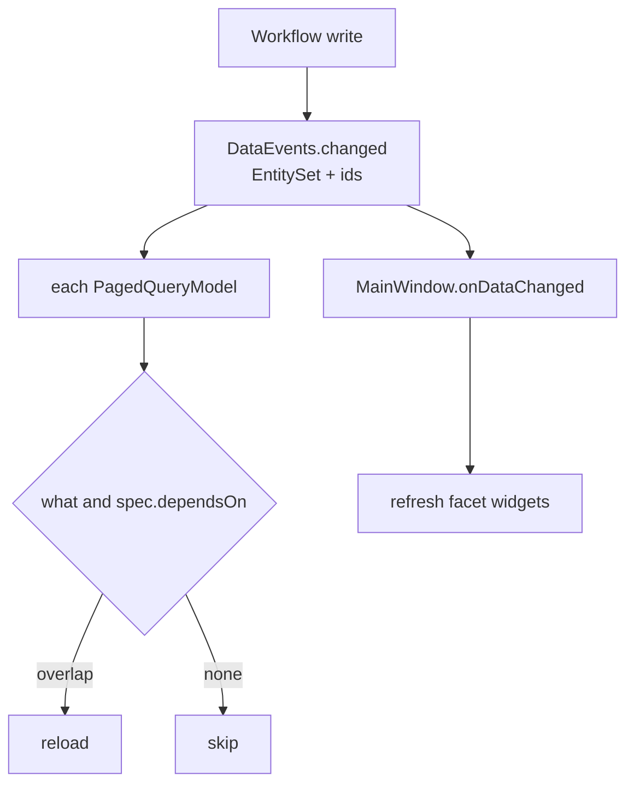

`Entity` flags: `Books`, `Copies`, `Members`, `Loans`, `Categories`.

| Spec | `dependsOn` |
| --- | --- |
| `BookListSpec` | Books, Copies, Categories |
| `MemberListSpec` | Members, Loans |
| `LoanListSpec` | Loans, Members, Copies, Books |
| `ArchivedMemberSpec` | Members, Loans |
| `ArchivedBookSpec` | Books, Copies |
| `ArchivedCopySpec` | Copies, Books, Loans |
| `ArchivedLoanSpec` | Loans, Members, Copies |

`BulkRunner` emits **one** event with every id that succeeded, not one per
row.

Startup, in order (`Application` constructor, then `main`):

1. App identity, window icon, desktop file name, Fusion style
2. `Paths::setProjectRoot` if unset
3. `Locale` load from `QSettings`, apply RTL + `QLocale`, install Qt catalogue
4. fonts, `Theme::loadSaved`, palette + stylesheet
5. `Paths::ensureLayout`
6. `DataEvents` and `QtErrorPresenter`
7. `InstanceLock`. If another copy of this installation runs, stop here
   (`isAlreadyRunning()`)
8. `Connection::open`. Refuse if a newer schema wrote the file. On failure,
   leave repositories unset (`isDatabaseReady()` false)
9. construct the four repositories on `connection.session()`
10. lookups, `OcrService`, facet and metrics sources, `QtDialogFactory`
11. `MainWindow` only if `isDatabaseReady()`

---

## 4. Layer stack

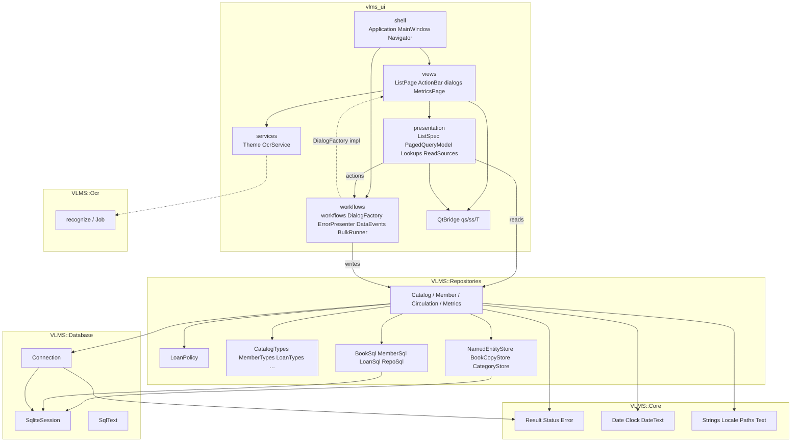

UI never talks to sqlite. Repositories never include Qt. OCR never includes
Core, Database, Repositories, or Qt. `QtBridge` is the only place that
converts `std::string` / `Core::Date` to `QString` / `QDate`.

Rules inside `vlms_ui`:

- Dialogs never hold a repository. They read through `CatalogLookups` /
  `MemberLookups` / `CirculationLookups`. Facet widgets read through
  `BookFacetSource` / `MemberFacetSource`, and `MetricsPage` through
  `MetricsSource`.
- Workflows never build a widget or a message box. They depend on the
  `DialogFactory` and `ErrorPresenter` interfaces; `QtDialogFactory` and
  `QtErrorPresenter` are the widget implementations.
- Only workflows write. Specs and views only read.

---

## 5. Error channel

There is no `lastError()` on repositories. A valued call returns
`Core::Result<T>`; a mutation returns `Core::Status`. The UI maps
`Error.key` through `Core::Strings::t`.

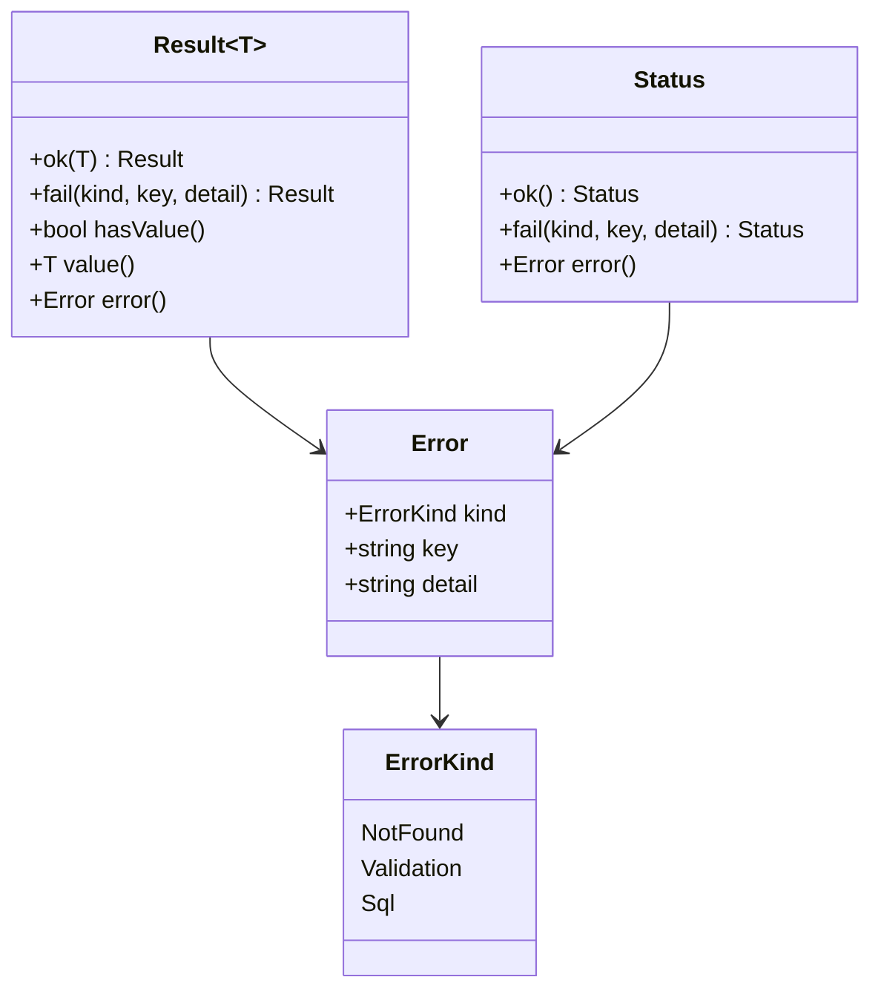

`RepoSql` (Repositories private) turns a driver fragment into
`ErrorKind::Sql` + key `error.sql`, or a validation / not-found `Status`.

`Connection` still uses a string `lastError()` for open/migrate failures.
That is process-startup, not a repository call.

---

## 6. Persistence

### 6.1 Session and schema owner

The class that opens the file, applies `database/schema.sql`, and runs
migrations is `VLMS::Database::Connection` (renamed from the old flat
`Database` so it does not collide with the `VLMS::Database` namespace).

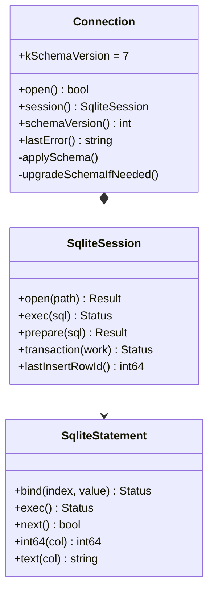

Notable migrations gated by `upgradeSchemaIfNeeded` (among others):
legacy shapes, catalog/language/description, member sex/email/archived/
spreadsheet columns, archive columns on books/copies/loans, member
`active_until`, date CHECKs, publication-date normalisation.

### 6.2 Catalog facade

`CatalogRepository` is a facade. Book rows, names, copies, and categories
are stores / SQL helpers sharing one session.

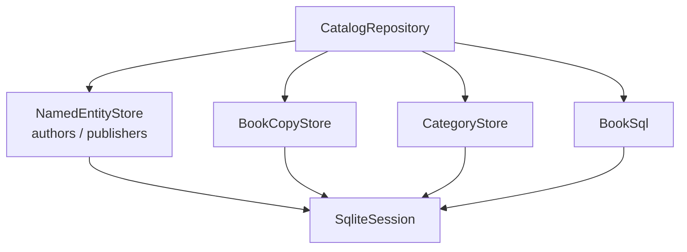

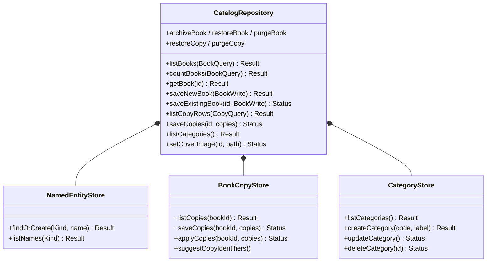

`saveNewBook` / `saveExistingBook` run book fields, copies, and cover copy
in **one** `SqliteSession::transaction`.

List queries take `ArchiveScope` (`Live` / `Archived` / `Any`). Live pages
pass `Live`; Archive passes `Archived`; history dialogs often use `Any`.

### 6.3 Members, circulation, archive funnel

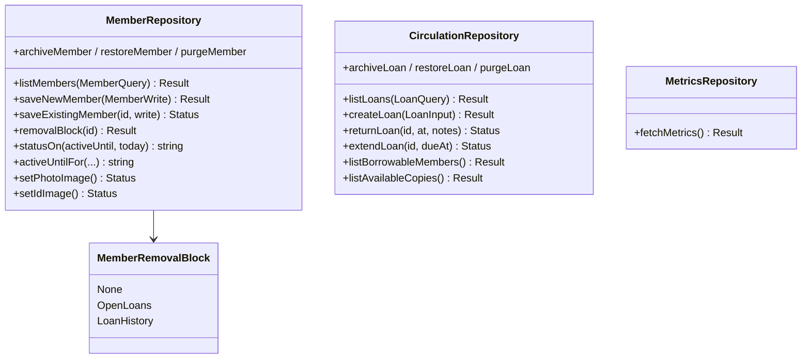

Member delete is not a single SQL `DELETE` (`MemberWorkflow::archive`):

- `OpenLoans` — refuse; the UI offers to jump to circulation
  (`Navigator::showMemberLoans`)
- otherwise — `archiveMember` (set `archived_at`, keep FKs)

`purgeMember` runs only from the Archive page (`ArchiveWorkflow::purge`).

Member **status is not a stored column**. A member is active while
`active_until` (last active day) is today or later. `statusOn` /
`activeUntilFor` derive and renew that date (register / renew → one year;
not active → ended yesterday).

`CirculationRepository` checks `memberCanBorrow` and `copyIsAvailable`
before insert. The unique index `idx_loans_one_open_per_copy` is the
constraint under that check.

Archive / restore / purge also exist for books, copies, and returned loans
(`canArchive*` / `canPurge*` are the read-only preflight answers).

---

## 7. Domain types

Plain structs in `VLMS::Repositories`. No Qt. No methods beyond data.

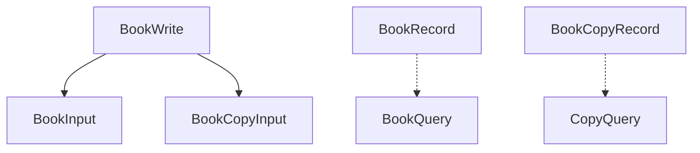

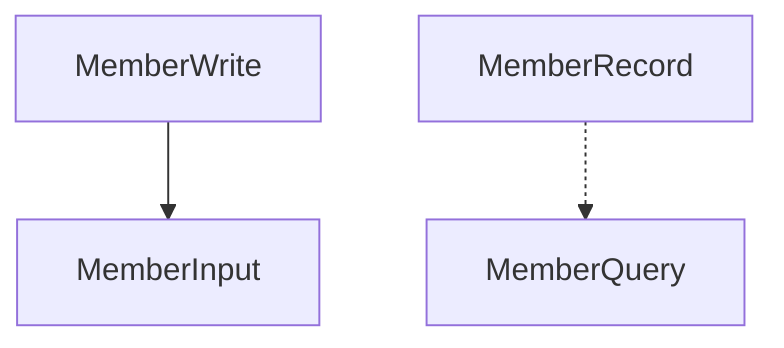

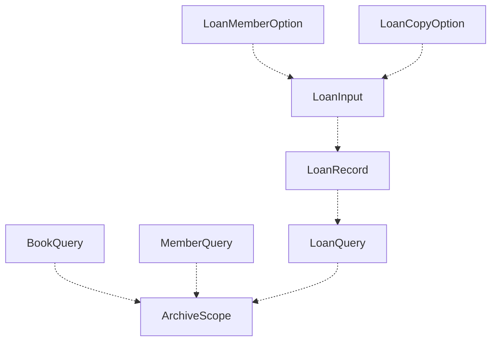

`LibraryMetrics` aggregates title/copy/member/loan counts plus
`MetricsPeriodCounts` for today / this week / this month, and
`topCategories`.

Value types in Core that are not records:

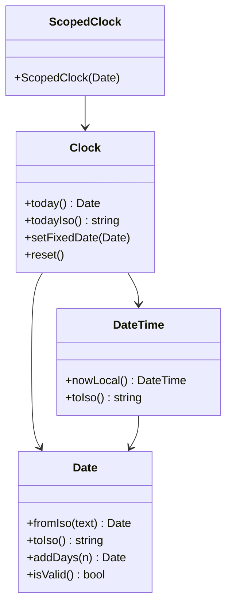

`Core::Clock` is the only allowed "now". C++ guards and SQL `:today` binds
must agree. Time is **local** (Africa/Tunis), not UTC
`date('now')`.

`Repositories::LoanPolicy` (14-day default) validates checkout, return, and
extension dates against `Clock::today()`.

---

## 8. UI classes

### 8.1 Shell

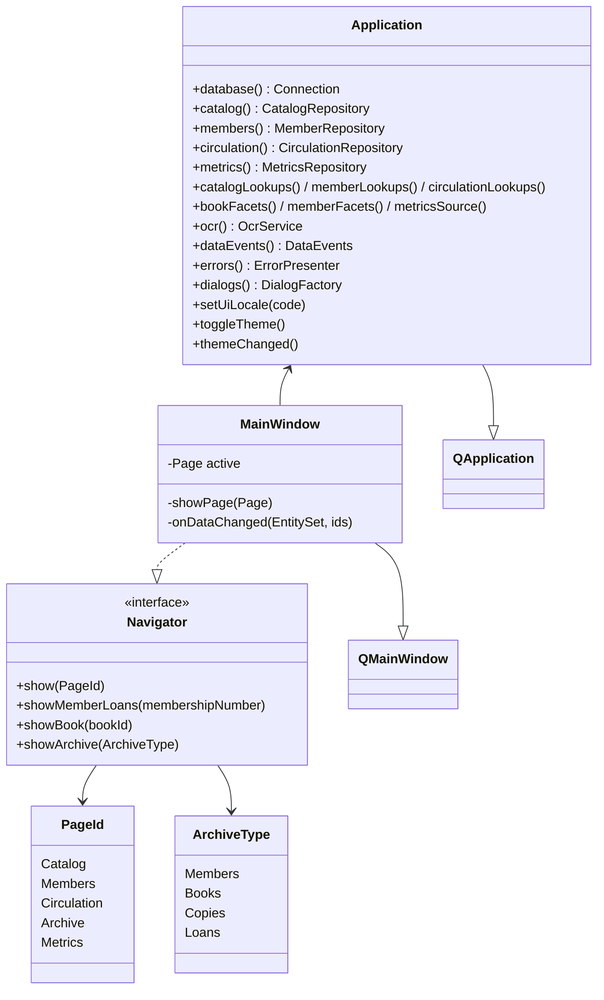

`MainWindow` listens to language and `themeChanged` and retranslates the
pages. Navigation is a `QStackedWidget`. The header also holds the
`LanguageSelector`, the theme toggle, and the user-manual button.
Workflows hold a `Navigator&`, not a `MainWindow&`. A member blocked by
open loans jumps to Circulation through `showMemberLoans`.

### 8.2 Workflows and dialogs

Every window a workflow opens comes from `DialogFactory`. A form method
returns an empty `optional` when the librarian cancels.

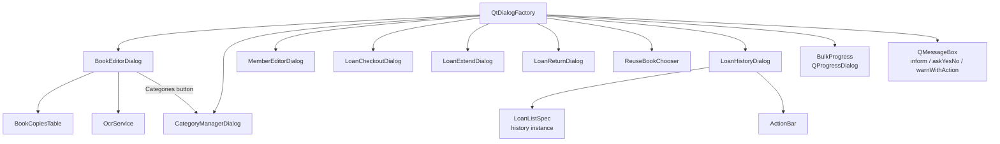

| `DialogFactory` call | Window | Returns | Used by |
| --- | --- | --- | --- |
| `editBook` | `BookEditorDialog` (`CatalogLookups`, `OcrService`) | `BookForm` | `BookWorkflow`, `ArchiveWorkflow::reuseNumber` |
| `manageCategories` | `CategoryManagerDialog` over `CategoryEditor` | — | `BookWorkflow` |
| `editMember` | `MemberEditorDialog` (`MemberLookups`) | `MemberForm` | `MemberWorkflow` |
| `checkout` | `LoanCheckoutDialog` (`CirculationLookups`) | `LoanForm` | `LoanWorkflow` |
| `returnLoan` | `LoanReturnDialog` | `ReturnForm` | `LoanWorkflow` |
| `extendLoan` | `LoanExtendDialog` | `ExtendForm` | `LoanWorkflow` |
| `chooseReuseTarget` | `ReuseBookChooser` | book id (0 = new) | `ArchiveWorkflow` |
| `showLoanHistory` | `LoanHistoryDialog` | — | book, member, archive workflows |
| `confirmBulk` / `startProgress` | message box / progress | bool / `BulkProgress` | `BulkRunner` |
| `inform` / `askYesNo` / `warnWithAction` | message box | bool | all workflows |

| Workflow | Writes through |
| --- | --- |
| `BookWorkflow` | `saveNewBook` / `saveExistingBook`, `archiveBook`, categories via `CategoryEditor` |
| `MemberWorkflow` | `saveNewMember` / `saveExistingMember`, `archiveMember` |
| `LoanWorkflow` | `createLoan`, `returnLoan`, `extendLoan`, `archiveLoan` |
| `ArchiveWorkflow` | `restore*` / `purge*` per `ArchiveType`, reuse of an archived copy number |

`LoanHistoryDialog` is one window for five kinds (`Book`, `Member`,
`ArchivedMember`, `ArchivedBook`, `ArchivedCopy`). It pins
`QueryState.pinned` on the history spec. Live kinds get return / extend
actions through `LoanWorkflow`; archived kinds are read-only.

`OcrService` owns `Ocr::Job`, polls it on a `QTimer`, and emits `textReady`
on the UI thread. The dialog stays a composer. `BookCopiesTable` uses
`runBulkAction` / `QtBulkUi` for rows it holds in memory.
`LicenceDialog` and `ImageViewerDialog` are shell helpers that write
nothing.

---

## 9. Cross-cutting services

```mermaid
flowchart TD
    App[Application]
    Loc[Core::Locale<br/>default ar]
    Str[Core::Strings::t]
    Th[Theme Light/Dark]
    P[Core::Paths]
    QB[QtBridge]

    App --> Loc
    App --> Th
    App --> P
    Loc --> Str
    QB --> Str
    QB --> Loc
```

- `Core::Locale` — `ar` / `fr` / `en`; `isRtl()` drives layout direction;
  Tunisian Arabic `QLocale` for calendars (Latin digits)
- `Core::Strings` — key tables, never raw driver text
- `Theme` — Fusion + stylesheet + palette for chrome Qt will not style
- `Core::Paths` — injected project root; Core never reads `QCoreApplication`
- `QtBridge` — `qs` / `ss` / `qsl` / `svl` / `qd` / `cd` / `T`

---

## 10. Data model

```mermaid
flowchart TD
    employees[employees]
    members[members]
    msh[member_status_history]
    authors[authors]
    publishers[publishers]
    categories[categories]
    books[books]
    copies[book_copies]
    loans[loans]

    members --> msh
    authors --> books
    publishers --> books
    categories --> books
    books --> copies
    members --> loans
    copies --> loans
    employees -.-> loans
    employees -.-> msh
```

Cardinalities and rules that matter:

- `books` 1—N `book_copies` (`ON DELETE CASCADE`)
- `members` 1—N `loans` (no cascade; archive instead)
- at most **one open loan per copy** (`UNIQUE` partial index)
- `archived_at` NULL means live; list queries filter via `ArchiveScope`
  on members, books, copies, and loans
- member status is **derived** from `active_until`, not stored on `members`
- `employees` exist for a default staff row and unused FK columns;
  there is no login UI in this build
- date columns use round-trip `CHECK (date(x) IS x)` / `datetime(x) IS x`
  guards where corruption must be rejected

Schema 7 vs the old schema-4 snapshot (high level): archive columns on
catalog and loans, member spreadsheet fields, `active_until`, email/sex,
publication date original, and stricter date CHECKs.

---

## 11. Sequences

### 11.1 Process start

```mermaid
flowchart TD
    A[main] --> B[Application ctor]
    B --> L{InstanceLock}
    L -->|held by another copy| X[say so, exit]
    L -->|ok| C{Connection::open}
    C -->|fail| D[showCritical<br/>app.databaseUnavailable]
    C -->|ok| E[four repositories<br/>+ adapters]
    E --> F[MainWindow<br/>workflows, specs, pages]
    F --> G[showMaximized]
    G --> H[app.exec]
```

### 11.2 Save a new book

```mermaid
flowchart TD
    P[Catalogue action add] --> W[BookWorkflow.add]
    W --> F[DialogFactory.editBook]
    F --> D[BookEditorDialog]
    D -->|cancel| Z[return ok]
    D -->|BookForm| WR[writeFor]
    WR --> S[saveNewBook]
    S --> T[session.transaction]
    T --> N[NamedEntityStore.findOrCreate]
    T --> B[insert book row]
    T --> C[BookCopyStore.applyCopies]
    T --> Cov[copy cover into resources/books]
    S -->|error| EP[ErrorPresenter.show]
    S -->|id| EV[DataEvents.changed<br/>Books + Copies]
    EV --> R[models reload<br/>facets refresh]
```

### 11.3 Checkout

```mermaid
flowchart TD
    C[Circulation action checkout] --> W[LoanWorkflow.checkout]
    W --> F[DialogFactory.checkout]
    F --> D[LoanCheckoutDialog]
    D --> M[CirculationLookups<br/>borrowable members, available copies]
    D --> P[LoanPolicy.validateLoanDates]
    D -->|LoanForm| R[createLoan]
    R --> MC[memberCanBorrow]
    R --> CA[copyIsAvailable]
    R --> INS[INSERT loans]
    INS --> IDX[idx_loans_one_open_per_copy]
    R -->|id| EV[DataEvents.changed<br/>Loans + Copies]
```

### 11.4 OCR a description

```mermaid
flowchart TD
    B[BookEditorDialog] --> C[OcrService.start]
    C --> J[Ocr::Job::start]
    J --> W[std::thread recognize]
    C --> T[QTimer poll]
    T --> D{job.done}
    D -->|no| T
    D -->|yes| E[take Result]
    E --> F[textReady]
    F --> G[appendRecognizedText]
```

### 11.5 Archive restore

```mermaid
flowchart TD
    A[Archive action restore] --> W[ArchiveWorkflow.restore]
    W --> N{one row}
    N -->|yes| Q[askYesNo]
    Q --> R[restoreMember / restoreBook / restoreCopy / restoreLoan]
    N -->|no| BR[BulkRunner.run]
    BR --> R
    R --> S[clear archived_at]
    S --> EV[DataEvents.changed<br/>entity for the type]
    EV --> L[live and archive models reload]
```

---

## 12. Tests

```mermaid
flowchart TD
    CoreT[libraries/Core/test<br/>test_vlms_core]
    DbT[libraries/Database/test<br/>test_vlms_database]
    RepoT[libraries/Repositories/test<br/>test_vlms_repositories]
    OcrT[libraries/Ocr/test<br/>test_vlms_ocr]
    UiT[applications/vlms/test<br/>test_vlms_ui]
    Env[Test::TestEnv]
    TDb[Test::TestDatabase]
    Seed[Test::TestSeed]
    Fakes[WorkflowTestSupport<br/>Fakes ModalTest]

    Env --> CoreT
    TDb --> DbT
    TDb --> RepoT
    Seed --> RepoT
    Seed --> UiT
    Fakes --> UiT
    CoreT --> CoreLib[vlms_core]
    DbT --> DbLib[vlms_database]
    RepoT --> RepoLib[vlms_repositories]
    OcrT --> OcrLib[vlms_ocr]
    UiT --> UiLib[vlms_ui]
```

Google Test. Core, Database, Repositories, and Ocr tests are Qt-free.
UI tests use Qt Widgets plus GTest. Test helpers live in `Test::`
(outside `VLMS`). `TestDatabase::scalar` treats SQL NULL as a null
`SqlValue`.

Workflow tests (`test_*_workflow.cpp`) run the real workflows over real
repositories on a seeded `TestDatabase` (`WorkflowTestSupport.h`).
`ModalTest.h` answers any real modal they raise. `FakeDialogFactory`,
`FakeErrorPresenter`, and `FakeNavigator` (`Fakes.h`) stand in for windows
in the bulk-runner, dialog-factory, and loan-history tests. Spec tests
(`test_*_spec.cpp`) check columns, actions, and loads without a page.
`test_paged_query_model.cpp` checks the reload-on-`dependsOn` rule.
`test_list_page*.cpp` and the page tests drive real widgets.

---

## 13. What this snapshot deliberately is not

- No member-facing web or mobile client
- No employee login, despite `employees` in the schema
- No Qt types in Core, Database, Repositories, or Ocr
- No sqlite3 link outside Database
- No second error channel on repositories
- No UTC clock in loan predicates
- No stored member-status column (status is derived from `active_until`)
- No writes from specs, views, or dialogs (only workflows write)
- No widget built inside a workflow (only through `DialogFactory`)
